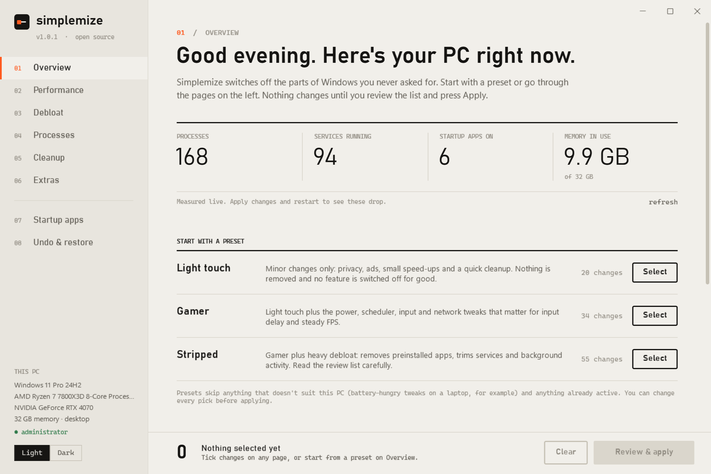

# simplemize

**Switch off the parts of Windows you never asked for.**

Simplemize is a small, free, open-source optimizer for Windows 10 and 11. It debloats Windows, trims what runs in the background and tunes it for lower input delay. It makes a System Restore point before it touches anything, saves the original value of every setting it changes, and explains every switch in plain words.

**[Download Simplemize.exe](https://github.com/Manow17/simplemize/releases/latest/download/Simplemize.exe)** · [Website](https://manow17.github.io/simplemize/) · single 309 KB file, no installer, no account, no telemetry



## What's inside

| Page | What it does |
| --- | --- |
| **Performance** | Ultimate Performance power plan, foreground priority, multimedia scheduler, Game Mode, Game DVR off, GPU scheduling, windowed-game optimizations, mouse acceleration off, Nagle off, network throttling, and more |
| **Debloat** | Telemetry and data-collection tasks, ads and tips, web results in Start, Copilot and Recall, Widgets, Edge background mode, OneDrive, and 40+ preinstalled apps (each one its own checkbox) |
| **Processes** | Rarely used services to Manual, SysMain, search indexing, Print Spooler, service grouping, background Store apps |
| **Cleanup** | Temp files, Windows Update cache, Delivery Optimization cache, crash dumps, DNS cache, component store cleanup, Recycle Bin. Sizes are measured first |
| **Extras** | File extensions, End task on the taskbar, classic right-click menu, driver updates through Windows Update, hibernation |
| **Startup apps** | Turn apps that launch at sign-in on or off, exactly like Task Manager |
| **Undo & restore** | Undo any change on its own or everything at once, plus step-by-step System Restore instructions |

The full list, with the exact registry values, services and tasks each change touches, is on the [website](https://manow17.github.io/simplemize/#tweaks). It's generated from the app, so it can't drift.

## Minor or heavy

Every change carries a label.

- **MINOR**: a small, targeted change. Fully reversible, and no feature disappears.
- **HEAVY**: changes a lot. It switches a Windows feature off, removes an app, or lowers a protection. Read the trade-off before you tick it.

Three presets get you started: **Light touch** (minor changes only), **Gamer** (adds the latency and FPS tweaks) and **Stripped** (adds heavy debloat). Presets skip anything that doesn't suit your PC, such as battery-hungry tweaks on a laptop.

## How to go back

1. **Undo inside Simplemize.** Original values live in `C:\ProgramData\Simplemize\backup.json`. The Undo & restore page puts them back exactly, one change at a time or all at once.
2. **System Restore.** Before its first change in each session, Simplemize creates a restore point named **Simplemize: before changes** (and turns System Restore on for your system drive if it was off). To use it: press <kbd>Win</kbd>+<kbd>R</kbd>, type `rstrui`, choose that restore point, Next, Finish.
3. **If Windows won't start.** Hold <kbd>Shift</kbd> and click Restart on the sign-in screen (or interrupt the boot three times), then Troubleshoot › Advanced options › System Restore.

Removed apps can't be restored by Simplemize or by System Restore; they're free to reinstall from the Microsoft Store.

## What it won't do

- Promise to double your FPS. It removes what gets in a game's way; the biggest single lever (Memory Integrity off) is marked as a security trade-off.
- "Clean" the registry, touch Windows Defender or the firewall, or block security updates.
- Clear the shader cache or Prefetch (that makes games stutter and apps load slower).
- Run in the background or connect to the internet.

## First run

**No pop-up:** paste this into PowerShell or Windows Terminal (<kbd>Win</kbd>+<kbd>X</kbd> › Terminal):

```powershell
irm https://manow17.github.io/simplemize/run.ps1 | iex
```

It downloads the latest release, checks it against the SHA-256 checksum published with the release, and starts it ([read the script](docs/run.ps1)). Files downloaded by PowerShell aren't tagged as "from the internet", so SmartScreen doesn't step in.

**Downloaded in a browser instead?** SmartScreen may say *"Windows protected your PC"* because the exe isn't signed with a paid code-signing certificate. Click **More info › Run anyway**, or build it yourself.

Simplemize asks for administrator rights. If you decline, it opens read-only so you can look around.

## Build it yourself

Requires Visual Studio 2022 or the free *Build Tools for Visual Studio* (for the C# compiler). Targets .NET Framework 4.8, which every Windows 10/11 PC already has.

```powershell
.\build.ps1          # -> dist\Simplemize.exe
```

## Try it without changing anything

```powershell
Simplemize.exe --sandbox            # full app, but every change is simulated; nothing on the PC is touched
Simplemize.exe --selftest out.txt   # applies and undoes every tweak in the sandbox and checks the result
```

The self-test runs twice: once against your PC's current state and once against a simulated fresh Windows install, so every tweak goes through a real off → on → off cycle. It also checks that the backup file survives a reload, that nothing is left behind, and that the real registry was never written. CI runs it on every push.

## License

MIT. Not affiliated with Microsoft.
